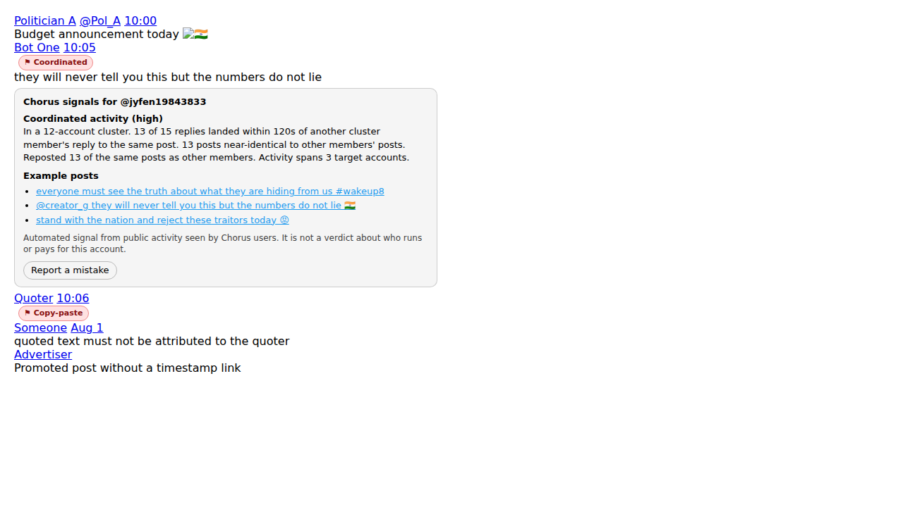

# Chorus

Chorus is a browser extension and a small backend that flag coordinated inauthentic activity and abuse-heavy accounts on X. Every flag comes with the evidence behind it.

It looks at how accounts behave, not which side they are on. It never uses political viewpoint as a feature.

| Label | What it means | Main evidence |
|---|---|---|
| **Coordinated activity** | The account is part of a cluster that repeatedly acts together | Replies within 2 minutes of other members on the same posts, near-identical text, co-reposting, activity spread across several target accounts |
| **Copy-paste talking points** | Its original posts are near-copies of posts by 2+ other accounts within a few hours | MinHash near-duplicate groups over top-level posts |
| **Frequent abusive content** | A large share of its posts that Chorus has seen are classified abusive or hateful | Per-post classifier score, English + 5 Indic languages + romanised Hinglish |

Chorus does **not** claim that an account is a bot or is paid. It cannot know either. It reports behaviour that it observed, and it shows that behaviour when you click the badge.



## How it works

```
 X page you are viewing                      Backend (FastAPI + SQLite)
 ┌───────────────────────┐   observations    ┌───────────────────────────────────────────┐
 │ content script        │ ────────────────▶ │ /v1/observations  store posts, replies,   │
 │  adapters/x.js reads  │                   │                   reposts, who saw them   │
 │  posts, replies,      │                   │ analysis loop (every 60s)                 │
 │  reposts from the DOM │                   │  1. classify new posts (abuse)            │
 │                       │   scores          │  2. near-duplicate groups (MinHash LSH)   │
 │ badges + evidence     │ ◀──────────────── │  3. account graph -> Louvain clusters     │
 │ panel next to names   │                   │  4. per-account scores + evidence         │
 └───────────────────────┘                   │ /v1/scores  /v1/appeals  /v1/clusters     │
                                             └───────────────────────────────────────────┘
```

The extension reads only what is already on your screen. It makes no background requests to X and does not scrape. Coverage grows with the number of people running it: the more users who open the same threads, the more of a ring becomes visible.

### Coordination scoring

The backend builds an account-account graph. Two accounts get an edge if they share at least 3 posts through any of these:

- synchronized replies (both replied to the same post within `sync_window_s`, default 120s)
- near-identical text (character 5-gram Jaccard ≥ 0.55, script-agnostic, so it works for Devanagari)
- co-reposts of the same post

Louvain clustering finds groups. Each member of a group of 3 or more is scored:

| Component | Weight | Measures |
|---|---|---|
| sync | 0.35 | share of its replies that landed next to another member's reply |
| dup | 0.30 | share of its posts that are near-copies of another member's post |
| diverse | 0.15 | how many different accounts its synchronized replies targeted |
| repost | 0.10 | posts co-reposted with members |
| template | 0.10 | handle looks auto-generated (`name12345678`) |

A label needs a score of at least 0.5, and at least 0.75 for "high". No single signal can reach 0.5 on its own. There is also a **single-target gate**: if a cluster only ever replies to one account and its text is not near-identical, nobody in it gets a label. Fans who get notifications and reply instantly to one celebrity look exactly like a timing-only ring, and the gate exists to protect them.

## Results

### Coordination and copy-paste (synthetic network, 10 random seeds)

`chorus/simulate.py` generates a network with known ground truth. It includes hard negatives: 30 fast-replying, co-reposting fans of one celebrity who share a stock phrase, and organic users with auto-generated digit handles.

| Group | Accounts (10 seeds) | Correctly labeled | Wrongly labeled |
|---|---|---|---|
| Ring A: templated handles, near-identical replies, 3 targets | 120 | 120 | 0 |
| Ring B: varied (LLM-style) text, synced, co-reposts, 3 targets | 80 | 79 | 0 |
| Ring C: varied text, synced, **one target**, no reposts | 80 | **0** (known miss) | 0 |
| Copy-paste campaign | 100 | 100 | 0 |
| Fans, organic users, target accounts (should get no label) | 3,380 | n/a | **0** |

This is a sanity check, not evidence that Chorus works on real data. The simulator and the detector were written together, so the detector is tuned to the simulator. Real validation needs labeled real-world networks. See the roadmap.

### Abusive-content classifier (real held-out test sets)

This is the baseline model: TF-IDF word and character n-grams with logistic regression, trained on HateXplain, MACD and TRAC-1 Hindi. It runs on CPU in seconds, and the model file is 8 MB.

| Test set | n | Precision @0.5 | Recall @0.5 | Precision @0.8 | Recall @0.8 |
|---|---|---|---|---|---|
| All | 34,164 | 0.87 | 0.84 | **0.95** | 0.67 |
| HateXplain (English) | 1,924 | 0.81 | 0.82 | 0.90 | 0.57 |
| MACD Hindi | 6,728 | 0.86 | 0.84 | 0.94 | 0.66 |
| MACD Tamil | 6,000 | 0.87 | 0.83 | 0.94 | 0.67 |
| MACD Telugu | 6,000 | 0.91 | 0.88 | 0.97 | 0.76 |
| MACD Kannada | 6,587 | 0.88 | 0.81 | 0.96 | 0.67 |
| MACD Malayalam | 5,170 | 0.83 | 0.83 | 0.92 | 0.64 |
| TRAC-1 Hindi/Hinglish | 1,755 | 0.88 | 0.90 | 0.94 | 0.68 |

The default post threshold is **0.8**, which favours precision. An account label also needs at least 5 scored posts, at least 3 of them flagged, and a flagged rate of at least 40%.

Why 0.8 and not 0.5: at 0.5, plain Hinglish political criticism gets flagged. For example, "sarkar ne kisano ke liye kuch nahi kiya" scores 0.73, because TRAC's "aggressive" class includes a lot of ordinary criticism. At 0.8 that sentence passes, but the problem is not solved. Test any model on benign political text from all sides before trusting it.

The baseline returns no score for scripts it was not trained on, such as Bengali or Urdu. Unfamiliar text produces confident false positives, and the simulator's made-up words showed exactly this during development.

## Quick start

### 1. Backend

```bash
cd backend
python -m venv .venv && source .venv/bin/activate
pip install -e ".[dev,train]"
python scripts/train_baseline.py      # clones the datasets with git, ~2 min on a laptop CPU
chorus-backend                         # http://127.0.0.1:8000
```

If you skip training, the backend still runs, but abuse labels are disabled. Coordination and copy-paste labels work without a classifier.

Check that it works:

```bash
pytest                                             # 25 tests
python scripts/simulate.py --url http://127.0.0.1:8000   # pushes a synthetic network, prints detection table
```

Run the simulation against a throwaway DB: `CHORUS_DB_PATH=/tmp/sim.db chorus-backend`.

### 2. Extension (Chrome, Edge, Brave)

1. Open `chrome://extensions` and turn on **Developer mode**.
2. Click **Load unpacked** and pick the `extension/` folder.
3. Browse X. Accounts with labels get a small badge next to their name. Click it for the evidence and a "Report a mistake" button.

The popup lets you turn labels on or off, stop sharing observations, blur replies from high-level flagged accounts, turn on test mode, and point the extension at a different backend.

### 3. Testing on live X

A fresh backend has no flags, so at first you will see no badges. Real labels appear only after the backend has seen the same accounts act together on at least 3 posts. Turn on **Test mode** in the popup to check that everything works before that:

- **Grey "⚑ Test" badge on your own posts.** It shows where real badges will appear and opens a panel the same way. It is created in your browser only and is never sent to the backend. Chorus finds your handle from X's side navigation; if that fails, type it in the popup.
- **Green dot after the name on every post Chorus has read.** Posts without a dot were missed, which usually means X changed its markup (see `extension/src/adapters/x.js`).
- **Status box in the bottom-left corner** showing posts read, posts sent, whether the backend is reachable, and how many flagged accounts are on screen.

To get real labels faster, open 5 to 10 threads where you suspect the same group of accounts is replying, then click "Re-analyze now". Check every flag by hand and keep a record of right and wrong ones; that record is the only real accuracy measure you will have.

If extraction breaks, copy a thread's HTML from DevTools (right-click `<main>`, Copy outerHTML) into `extension/test/fixtures/`, write a test against it, and fix `adapters/x.js`. You can also run `ChorusX.extractPage(document, location.pathname)` in the DevTools console after switching the context dropdown from "top" to "Chorus".

Extension tests: `cd extension && npm install && npm test` (12 tests, run in jsdom).

Real-browser check: `tools/e2e_browser.py` loads the unpacked extension in Chromium through Playwright, serves a fixture thread in place of x.com, clicks a badge and saves a screenshot. The image above came from it.

## Configuration

Every setting in `backend/chorus/config.py` can be set with an env var of the form `CHORUS_<NAME>`. The main ones:

| Variable | Default | |
|---|---|---|
| `CHORUS_DB_PATH` | `chorus.db` | SQLite file |
| `CHORUS_CLASSIFIER` | `auto` | `baseline`, `transformers`, `none`. `auto` uses baseline if the model file exists |
| `CHORUS_ABUSE_POST_THRESHOLD` | `0.8` | per-post abuse cutoff |
| `CHORUS_SYNC_WINDOW_S` | `120` | what counts as a synchronized reply |
| `CHORUS_LABEL_THRESHOLD` | `0.5` | coordination score needed for a label |
| `CHORUS_MIN_OBSERVERS` | `1` | a post only counts once this many distinct extension installs have reported it |
| `CHORUS_ADMIN_TOKEN` | empty | enables `/v1/admin/*` (appeal review, suppressing labels) |
| `CHORUS_RETENTION_DAYS` | `30` | older observations are deleted |

**Transformer models (optional).** Set `CHORUS_CLASSIFIER=transformers` after `pip install -e ".[transformers]"`. The default spec runs `cardiffnlp/twitter-roberta-base-hate-latest` (English) and `Hate-speech-CNERG/indic-abusive-allInOne-MuRIL` (Indic plus code-mixed) and takes the higher score. This path is unit-tested with a mocked pipeline only and has not yet been evaluated against the real models. Check the MuRIL model card for which label means abusive before relying on `LABEL_1`, and evaluate it with the same test sets as above.

## API

| Method | Path | |
|---|---|---|
| POST | `/v1/observations` | batch of `{posts, reposts}` from one client |
| POST | `/v1/scores` | `{platform, handles[]}`: status, labels, evidence, caveat |
| GET | `/v1/accounts/{platform}/{handle}` | full evidence for one account |
| GET | `/v1/clusters/{platform}` | detected clusters with stats |
| POST | `/v1/analyze` | run analysis now |
| POST | `/v1/appeals` | "this label is wrong" |
| GET/POST | `/v1/admin/appeals`, `/v1/admin/overrides` | needs `X-Admin-Token` |
| GET | `/health`, `/v1/stats` | |

Interactive docs are at `/docs` while the backend is running.

## Before you host this for other people

The default setup is one person with a local backend. A shared backend needs more work first.

- **Poisoning.** Anyone who can POST to `/v1/observations` can invent replies to get someone else labeled. Set `CHORUS_MIN_OBSERVERS` to 2 or more so that a single client cannot create evidence. Add authentication and rate limits too; neither exists yet.
- **Defamation.** Labels about named people are published statements. Read `docs/labeling-policy.md`. Keep the evidence panel and appeals working, and do not change the wording from behaviour ("coordinated activity") to accusations ("paid troll", "bot").
- **Platform terms.** The extension reads pages the user opens. It does not crawl. Still, check X's terms and your local law before running a shared service that stores what users saw.
- **Dataset licences.** HateXplain is MIT and TRAC-1 is Apache-2.0. MACD has no licence file, so treat it as research-only: do not redistribute the data, and think carefully before shipping a model trained on it commercially. `data/` and `*.joblib` are gitignored for this reason. Each user trains locally.

## Known limitations

- **Single-target rings with varied text are missed** (Ring C above). This is the price of not flagging fandoms. Adding account age (from profile hover cards) and posting-rhythm features is the most promising fix.
- **Paid influencers cannot be detected as paid.** Chorus catches the behaviour they often share, such as copy-paste talking points and coordinated boosting, and says only that.
- **Coverage depends on users.** One user sees a small slice. Clusters appear only when enough of a ring's activity is observed.
- **X markup changes.** Everything that reads the page lives in `extension/src/adapters/x.js` and uses `data-testid` hooks. When X changes its markup, that file is the only one to fix, and `extension/test/fixtures/` needs updating to match. Repost detection matches the English "reposted" text.
- **The classifier detects abuse, not specifically hate.** Profanity-heavy but harmless accounts can score high. The account-level thresholds reduce this but do not remove it.
- **SQLite and in-process analysis** are fine up to roughly hundreds of thousands of posts. Past that, move to Postgres and a job queue.

## Roadmap

1. Instagram adapter (`extension/src/adapters/instagram.js`) for comment sections and likes.
2. Account-age and profile features from hover cards.
3. Evaluate coordination on real labeled data: the X information-operations archive, the labeled IO control datasets on Zenodo, and TwiBot-22 for account-level features.
4. Fine-tune MuRIL on MACD plus HASOC plus TRAC as a better default classifier, with a benign-political-speech test set covering all sides.
5. Cluster pages that show a whole network, not just one account.

## Project layout

```
backend/
  chorus/
    api.py            FastAPI app and entry point
    analysis.py       pipeline: classify -> near-dups -> coordination -> labels
    coordination.py   account graph, Louvain, per-member scoring and gates
    textsim.py        normalization, MinHash LSH near-duplicate groups
    classifier.py     baseline / transformers / none, script gating
    db.py             SQLite store
    config.py         settings (env overridable)
    simulate.py       synthetic network with ground truth
  scripts/
    train_baseline.py train + evaluate the classifier on real datasets
    simulate.py       push a synthetic network into a running backend
  tests/              pytest
extension/
  manifest.json
  src/adapters/x.js   all X-specific DOM reading
  src/content.js      queueing, badges, evidence panel
  src/background.js   backend calls, score cache
  src/popup.*         settings
  test/               node:test + jsdom
tools/e2e_browser.py  real-Chromium smoke test (Playwright)
docs/labeling-policy.md
```

## Credits

Datasets: HateXplain (Mathew et al., AAAI 2021), MACD (Gupta et al., NeurIPS 2022 Datasets and Benchmarks), TRAC-1 (Kumar et al., 2018). Models referenced: Cardiff NLP twitter-roberta-base-hate-latest (Antypas and Camacho-Collados, WOAH 2023) and Hate-ALERT / CNERG Indic MuRIL models (Das et al., HT 2022).

## Licence

MIT. See `LICENSE`. Dataset and model licences are separate and belong to their authors.
